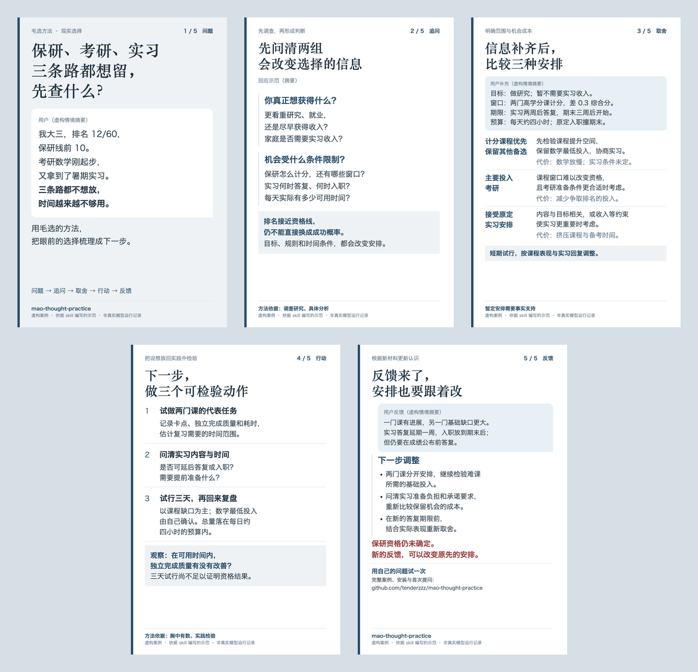

# mao-thought-practice

**用毛选的方法，把现实选择梳理成可检验的下一步。**

用《毛泽东选集》中的矛盾分析、实践认识、调查研究和战略方法，帮助理解现实处境、比较选择，并通过行动和反馈修正判断。

[先看三轮演示](references/baoyan-kaoyan-internship-demo.md) · [安装并试一次](#安装并试一次) · [查看其他案例](references/case-studies.md)

## 先看一个问题：保研、考研、实习，如何取舍？

> 我大三，排名 12/60，保研线前 10，考研数学刚起步，又拿到了暑期实习。三条路都不想放，时间越来越不够用。用毛选思路帮我分析。

[](docs/baoyan-kaoyan-internship-post.md#五张图发布顺序)

演示从这三个地方展开：

- **先补信息**：目标、计分规则、课程提升空间、实习期限与经济需要，会改变选择。
- **再做取舍**：比较几种安排的适用条件与机会成本，给出能在现有时间内试行的动作。
- **带反馈回来**：实习条件变化、课程比预想更难时，重新分配投入，并保留仍未解决的不确定性。

**[查看完整对话与判断修正 →](references/baoyan-kaoyan-internship-demo.md)** · [下载五张图与发布文案](docs/baoyan-kaoyan-internship-images.zip)

*人物、数据、对话和反馈均为虚构；回答是依据 skill 编写的示范，不是某次模型运行记录或录取结果。实际输出会随模型、提供的信息和宿主工具变化。*

## 安装并试一次

使用 Hermes Agent 时，把整个仓库安装到技能目录：

```bash
git clone https://github.com/tenderzzz/mao-thought-practice.git ~/.hermes/skills/mao-thought-practice
```

请保留整个目录，供模型按需读取 references。已有安装可在该目录更新仓库；技能加载与刷新方式以宿主版本为准。[其他工具的使用方式](#其他工具与运行说明)见下文。

确认宿主已加载 skill 后，复制下面的提问，把方括号换成自己的情况；不知道的信息可以写“不清楚”。

```text
用毛选的方法帮我分析保研、考研和实习的取舍。
我真正看重的结果：[读研方向、就业、收入或其他目标]
已知规则与进度：[排名、计分规则、备考进度、实习内容]
关键日期：[实习答复与入职、考试、资格确认等]
可用时间与现实限制：[每天可用时间、经济需要、其他义务]
已经试过的办法与结果：[按实际填写]
请先指出会改变判断的信息缺口，再比较方案，给出可检验的下一步。
```

试行后可以接着说：

```text
接着上次的分析复盘：我实际做了……，观察到……，条件变成了……。
请检查原判断哪些仍成立、哪些需要修改，再调整下一步。
```

本 skill 提供可追溯的理论出处和有条件的生活应用。现实建议仍需事实与实践反馈支持。

## 怎么使用

| 模式 | 示例 | 输出重点 |
|---|---|---|
| 完整分析 | “用毛选思路分析保研、考研和实习如何取舍。” | 事实与缺口、矛盾关系、条件和取舍、可检验行动 |
| 概念答疑 | “主要矛盾与矛盾的主要方面有什么区别？” | 出处、语境、准确解释和必要例子 |
| 快速三问 | “明早交申请，周末考试，今晚先做什么？” | 关键约束、改变选择的条件、下一步 |
| 带反馈继续 | “按上次建议练了一周，发现卡在任务拆解。” | 检查原判断、比较解释、调整行动 |

完整分析的骨架是：

> 摆事实与划边界 → 析矛盾与找机制 → 判过程与转变条件 → 选策略与比较取舍 → 化为可检验行动 → 复盘更新认识

信息不足时先补会改变判断的材料；不强行选主要矛盾，也不把所有困难都套进防御—相持—反攻。简单答疑、日常选择和单纯倾诉按实际需要处理。

例如只知道“保研在边缘，同时备考并拿到了实习”，还不能认定哪条路最稳。应先了解目标、规则、差距、期限与经济需要，再比较方案。初次答复、补充信息后的分析、实践反馈后的修正，见 [使用案例](references/case-studies.md)。

可用以下信息开始，也可以直接讲你的问题：

```text
用毛选的方法帮我分析：
现状和形成过程：
真正想解决的选择、目标与期限：
已有资源和限制：
试过什么、实际结果如何：
最不确定的地方：
```

## 其他工具与运行说明

请保留整个目录，让模型能按需读取 references；只复制 SKILL.md 会丢失理论说明、案例和出处。

### 其他支持技能目录的工具

将整个文件夹放入工具识别的技能目录，或明确让模型读取本文件夹中的 SKILL.md 并按需读取引用资料。普通聊天环境可提供需要的参考文件；不要假定模型能自动访问未上传的目录。

核心分析不依赖脚本或联网。原文查阅工具是可选功能，需要 Python 3.9+，只用标准库。

## 资料结构

```text
SKILL.md                         触发范围、模式、分析骨架与质量要求
references/
  theory-core.md                 核心理论及使用边界
  strategy-toolbox.md             16 项策略的条件、用法与切换信号
  glossary.md                    24 个概念的解释与常见混淆
  works-guide.md                 按问题选择篇目的阅读路线
  scenario-mapping.md             现实场景中的调查重点
  case-studies.md                 不同场景的使用案例
  baoyan-kaoyan-internship-demo.md 保研、考研、实习的完整三轮演示
  sources.md                     原文索引与引用方法
  sources.json                   22 篇来源、短引、位置与版本校验值
assets/                          README 演示图与五张发布图
docs/                            发布文案、图包与发布步骤
scripts/source_lookup.py          原文检索与核验
tests/                           脚本检查与行为评估场景
NOTICE.md                        第三方材料与收录边界
LICENSE                          原创部分的 MIT 许可
```

## 原文如何使用

已核对与本 skill 直接相关的 22 篇原文，保留必要短引、篇名日期、语境、应用限制和固定版本链接。核对对象是用户提供的 [全文网站](https://echonoshy.github.io/Maozedong-xuanji/) 所用转录文本，未宣称通读全部 229 篇或已完成纸本版本校勘。

```bash
python3 scripts/source_lookup.py list
python3 scripts/source_lookup.py show S01 --find 主要的矛盾
python3 scripts/source_lookup.py show S13 --find 不打无准备之仗
python3 scripts/source_lookup.py verify
python3 scripts/source_lookup.py verify --offline
```

show 返回带来源和行号的有限上下文，过长内容标明截断；未命中、网络失败或核验失败会返回非零状态，不伪造结果。第一次查阅从固定 commit 下载文章并检查 Git blob SHA，之后使用相同版本缓存。默认缓存位于系统临时目录中的 mao-thought-practice，可通过 MAO_THOUGHT_CACHE 指定仓库之外的目录；临时缓存可能被系统清理。离线且没有缓存时仍可使用已收录的短引和释义，但不能声称已核对更多原文。

上游文本仓库未声明明确的开源许可。本仓库采用**必要短引与来源索引，全文按需在本机查阅**的方式，未将五卷全文或 PDF 随仓库再分发。MIT 适用于本项目的原创指令、解释、示例和程序，不覆盖第三方原文；详见 [NOTICE.md](NOTICE.md)。

## 维护与验证

```bash
python3 -m unittest discover -s tests -p 'test_*.py'
python3 scripts/source_lookup.py verify
```

结构检查和引文匹配不能证明分析有效。[行为评估场景](tests/evaluation.md) 检查实际回答是否编造事实、误判层次、机械套阶段，以及能否根据反证修正。维护时记录实际输出与失败原因，再作有针对性的修改。
