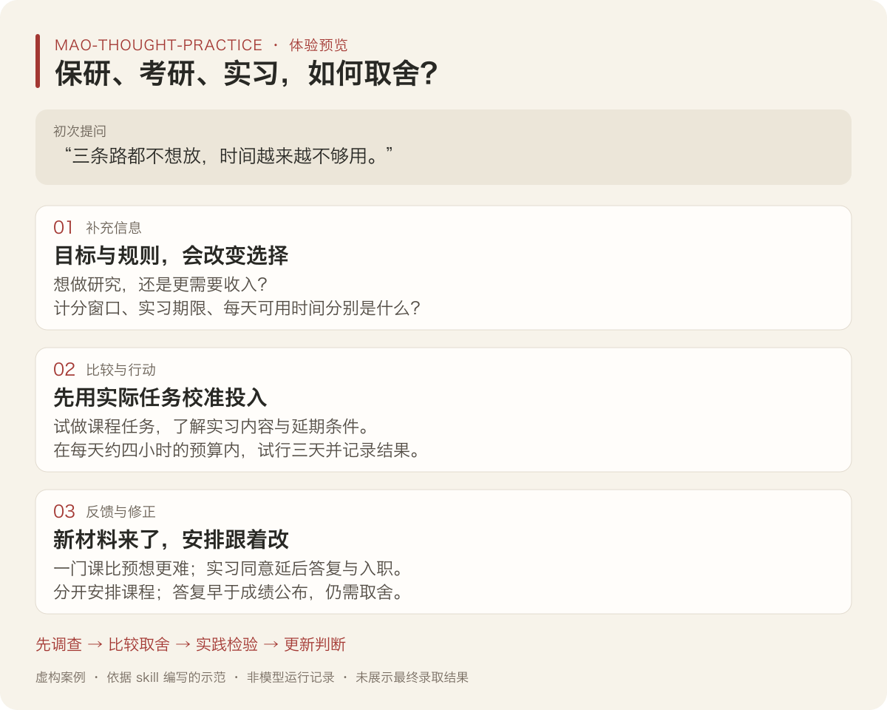

# 保研、考研、实习都想留：用毛选的方法，先查什么？

[返回 README](../README.md) · [安装并试一次](../README.md#安装并试一次)

> **虚构演示**：人物、规则、数据、对话和反馈均为编写示范，不是实际模型运行记录、真实学校规定或录取结果。示范展示调查、取舍和判断修正；具体建议只适用于这里给出的条件。

## 第一轮：三条路都不想放，先问什么？

**用户**

> 我大三，排名 12/60，保研线前 10，考研数学刚起步，又拿到了暑期实习。三条路都不想放，时间越来越不够用。用毛选思路帮我分析。

**回应示范**

你现在同时保留三条路径，感觉时间不够用。现有信息还不足以判断哪条路径最有价值，或三条路径是否真的无法兼顾。排名接近资格线，也不能直接换成成功概率。

先补两组会改变选择的信息：

1. **你想获得什么？** 更看重研究、就业还是尽早收入？家庭是否需要你靠实习获得收入？
2. **机会受什么条件限制？** 保研按什么规则计分，分差和剩余计分项目是什么；实习何时答复、何时入职，内容是什么；你每天实际有多少时间，三条路径具体如何冲突？

如果你明确想做研究，而且剩余课程存在可争取的窗口，短期集中学业可能有价值；如果收入是硬约束，或者实习直接提供你需要的经验，安排就可能不同。

今天先把已知规则和关键日期整理到一张表里。尚缺的信息可以标出来，优先核查会影响近期承诺的部分。

## 第二轮：补充信息后，怎样比较安排？

**用户补充 · 虚构**

> 我更想做研究，家庭暂时不需要实习收入。按学校已公布的规则，今年名额是前 10；我目前排 12/60，和第十名差 0.3 综合分。本学期还有两门高学分课计入排名，但我不知道能提高多少。实习两周后要答复，期末三周后开始，原定入职会撞上期末。实习具体做什么还没问清。目前每天实际可用约四小时。

**回应示范**

**先划定范围。** 这次先解决未来三周怎样分配投入，以及实习答复前需要弄清什么。长期目标是读研做研究，短期安排要为它服务。

**已知与未知。** 你仍有课程计分窗口，但能否取得保研资格没有确定；第十名的成绩也可能变化。考研可作为另一条读研路径，当前基础和后续任务量仍需评估。实习是否支持研究目标、是否能调整时间，尚未核实。

**矛盾关系。** 在这个时间范围内，维持三条路径所需的投入与每天约四小时的可用精力，可能互相牵制。它会影响课程、数学和实习准备，但还缺任务估时，暂不能断定资源已经不足，更不能据此替你决定放弃哪一条。

先比较三个可行方向：

| 暂定安排 | 哪些条件支持它 | 需要承担的取舍 |
|---|---|---|
| 先试行以计分课程为主，同时保留考研最低投入，并协商实习时间 | 课程缺口在可用时间内有改善空间，且实习可协商 | 数学进度会放慢；实习可能无法按原条件保留 |
| 主要投入考研 | 课程窗口经核查难以改变资格，且考研目标与准备条件更合适 | 减少争取本学期排名的投入，也可能失去实习机会 |
| 接受原定实习安排 | 实习内容与目标高度相关，或收入等约束使它更重要 | 原定时间冲突仍在，可能挤压课程与备考；需重新评估承诺 |

根据目前的偏好和计分窗口，可以先检验第一种安排。它是短期试行，需要课程表现和实习回复来决定是否继续。

### 接下来做什么？

1. **明天前试做两门课的代表性任务。** 按考试要求独立尝试，记录卡点、完成质量与耗时，估计复习需要的时间范围；结合计分规则看提升空间，同时保留他人成绩变化的不确定性。
2. **在实习答复前问清内容与时间。** 了解具体工作、是否可延后答复或入职，以及需要提前准备什么。依据对方实际回复评估保留机会的成本。
3. **用随后三天试行一个可承受的安排。** 以课程缺口为主，保留你认可的考研数学最低投入；总量落在每天约四小时的预算内。记录独立完成情况、耗时和实际负担。

这里的试验是：**如果当前主要障碍是投入分散，集中后应能在时间预算内改善课程任务的完成质量；如果时间够用但仍卡在具体知识或方法上，就需要调整训练与反馈；如果总量持续超过预算，就要进一步减少承诺。**

建议三天后、且在实习答复前复盘。三天的观察只能帮助校准任务量和学习方法，尚不足以证明最终成绩或资格结果。

## 第三轮：新反馈来了，原判断怎么改？

**用户反馈 · 虚构**

> 三天试了下来，每天基本控制在四小时。一门课的同类题已经能独立做，另一门课的基础缺口比预想大，进度慢。数学只保留了每天一小组题。实习方同意把答复延期一周，入职可以放到期末考完后；内容是整理实验数据和写小脚本。不过正式答复仍早于两门课成绩公布。

**回应示范**

这次反馈改变了两处判断：

- **实习的时间条件变了。** 入职与期末的直接冲突减轻，也多了一周调查时间；但答复仍早于成绩公布，保研结果未定时如何承担承诺，仍需取舍。
- **课程的投入难度变清楚了。** 一门课的试做结果支持继续当前方法；另一门课需要更大的基础投入。应分开安排两门课，避免沿用相同的提分预期。

实习内容可能与研究训练有联系，但还需要了解实际指导、任务质量和准备负担。仅凭“实验数据”几个字，也不能认定它比其他路径更有价值。

建议接下来这样调整：

1. 让基础缺口较大的课程成为下一次检验重点，找出最先阻塞推进的知识点，并争取针对性反馈。观察补上它后，能否独立完成相近任务；另一门课继续巩固，数学最低投入由你结合实际负担确认。
2. 问清延后入职的具体日期、准备任务和承诺要求。如果实习准备仍挤占课程时间，重新比较代价；如果能在期末后开始且负担可承受，保留它的条件更充分。
3. 在延后的答复期限前，结合课程完成质量、剩余时间、实习条件和考研进度重新比较方案。基础缺口若仍超出可承受投入，就要调整目标或时间分配；若出现可重复的改善，可以继续验证。

原先“先以计分课程为主做短期试行”的安排获得了部分支持，也需要按课程差异调整。保研资格仍未确定，示范到此没有虚构最终录取结果。

## 毛选的方法具体用在哪里？

| 方法依据 | 这次应用到的地方 |
|---|---|
| 《反对本本主义》（1930）中的调查方法，S03 | 先查目标、计分规则、任务与时间条件，避免凭经验直接选路 |
| 《矛盾论》（1937）的具体分析，S01 | 在明确的范围和阶段里说明投入要求与可用精力如何互相制约，保留尚未证实的判断 |
| 《党委会的工作方法》（1949）中的“胸中有数”和“弹钢琴”，S14 | 校准任务量，安排当前重点与其他任务的维持线 |
| 《实践论》（1937）的实践与认识循环，S02 | 用代表任务和实际回复检验设想，再修正课程投入与实习安排 |

上表是方法释义与生活应用；来源、语境与限制见 [原文索引](sources.md) 和 [核心理论](theory-core.md)。本页没有把生活建议当成毛泽东原话。

## 用你的情况试一次

[回到安装与首次提问入口](../README.md#安装并试一次)。把目标、规则、期限和可用资源换成自己的情况；信息不完整时，也可以直接描述你眼前的问题。

如果已经试过一轮，带着实际行动、观察结果和条件变化继续复盘。
